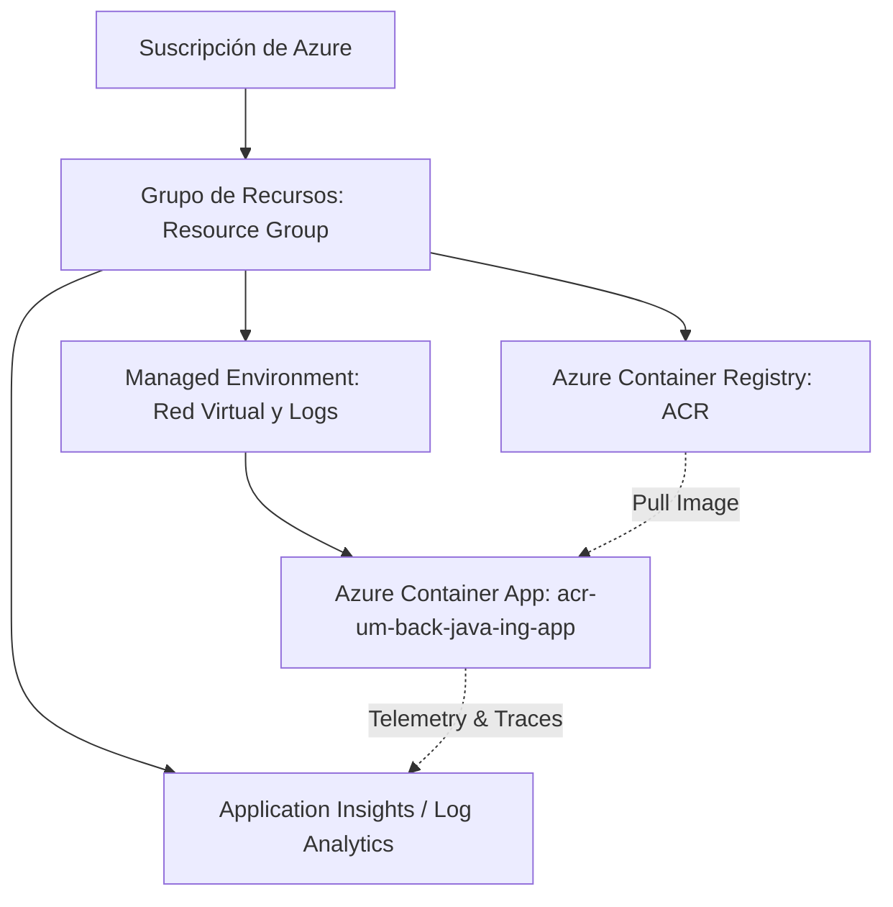
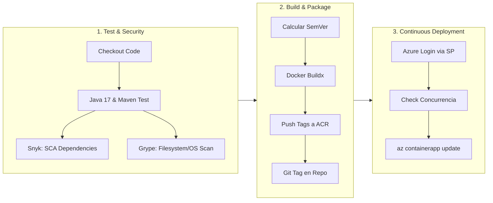

# Guía de Estudio y Arquitectura: CI/CD, Azure Cloud & The Twelve-Factor App

Este documento reúne todos los conceptos técnicos, decisiones de arquitectura, flujo de integración y despliegue continuo (CI/CD), seguridad y monitoreo evaluados para el proyecto **Dental Management Backend** desplegado en **Microsoft Azure**.

---

## 1. Jerarquía de Recursos en Microsoft Azure

La infraestructura en la nube de Azure se organiza de forma jerárquica:



### Ubicación y Funcionalidad de los Recursos
* **Grupo de Recursos (Resource Group):** Contenedor lógico que agrupa todos los servicios del proyecto bajo un mismo ciclo de vida y región geográfica (`East US`).
* **Azure Container Registry (ACR):** Repositorio privado de imágenes Docker.
  * **¿Dónde ver las imágenes versionadas?:** En el portal de Azure: `ACR -> Repositorios (Repositories) -> acr-um-back-java-ing -> Etiquetas (Tags)`. Aquí se observan las versiones semánticas (ej. `v1.1.0`) y el puntero `latest`.
* **Azure Container Apps (ACA):** Servicio de cómputo serverless basado en Kubernetes administrado donde corre el contenedor del microservicio (`acr-um-back-java-ing-app`).
* **Red (Networking):** Todos los componentes residen en el mismo Grupo de Recursos. El *Managed Environment* proporciona la red interna y un controlador de *Ingress* que expone el puerto `8080` hacia el exterior mediante HTTPS/TLS con certificado gestionado por Microsoft.
* **Application Insights:** Plataforma de observabilidad centralizada conectada al *Log Analytics Workspace* para recolectar trazas distribuidas, métricas y registros del contenedor.

---

## 2. Service Principal (Entidad de Servicio)

* **Definición:** Es una **identidad no humana** (cuenta de servicio) creada en Microsoft Entra ID (Azure Active Directory) destinada a la automatización de procesos entre plataformas.
* **Propósito en el proyecto:** Permite que el pipeline de **GitHub Actions** ejecute el comando `az login` y administre recursos en Azure de forma autónoma, sin utilizar credenciales interactivas personales.
* **Almacenamiento y Formato:**
  * Se almacena de forma cifrada en **GitHub Repository Secrets** bajo el nombre `AZURE_CREDENTIALS`.
  * Formato JSON:
    ```json
    {
      "clientId": "<GUID-del-Service-Principal>",
      "clientSecret": "<Clave-Secreta-Generada>",
      "tenantId": "<GUID-del-Tenant-de-Azure>",
      "subscriptionId": "<GUID-de-la-Suscripcion>"
    }
    ```
  * Posee el rol `Contributor` restringido al ámbito (*scope*) del Grupo de Recursos del proyecto.

---

## 3. Pipeline de CI/CD (GitHub Actions — `ci.yml`)

El pipeline automatizado se divide en tres fases secuenciales:



### Detalle de las Etapas

| Etapa | Responsabilidad | Herramientas |
| :--- | :--- | :--- |
| **1. Test & Security (CI)** | Ejecución de tests unitarios y auditoría de vulnerabilidades. | `mvn test`, **Snyk**, **Grype** |
| **2. Build & Versioning (CD)** | Determinación de versión semántica, build multi-stage y publicación de imagen. | Docker Buildx, Azure Container Registry (ACR) |
| **3. Deploy (CD)** | Verificación de concurrencia en Azure y actualización del contenedor activo. | Azure CLI (`az containerapp`), Service Principal |

### Diferencia Crítica de Seguridad: Snyk vs. Grype

* **Snyk (SCA - Software Composition Analysis):**
  * Analiza el **código fuente y las dependencias de la aplicación** declaradas en el gestor de paquetes (`pom.xml` en Java).
  * Detecta vulnerabilidades conocidas (CVEs) en librerías de terceros (Spring Boot, Jackson, JJWT, Hibernate).
* **Grype (Container & Filesystem Scanner):**
  * Analiza las capas del **sistema operativo base del contenedor** y el sistema de archivos.
  * Detecta paquetes obsoletos o vulnerabilidades a nivel de distribución Linux (Debian, OpenSSL del SO, paquetes binarios del sistema).

### Reglas de Versionado Semántico y Despliegue Condicional
El script de metadatos en el pipeline analiza el mensaje del commit:
* `feat:` o `feat(...)`: Incrementa la versión **minor** (`v1.0.0` -> `v1.1.0`).
* `fix:` o `refactor:`: Incrementa la versión **patch** (`v1.1.0` -> `v1.1.1`).
* **Omisión de Despliegue (*Skip Deploy*):** Si el mensaje contiene `chore:`, `doc:`, `docs:` o el flag `/notdeploy`, el pipeline ejecuta los tests y los escaneos de seguridad pero **omite el despliegue a Azure**, optimizando tiempos y evitando revisiones innecesarias.
* **Control de Concurrencia en Azure:** Antes de aplicar `az containerapp update`, el script ejecuta un bucle activo de consulta (*polling*) esperando que `provisioningState` sea `Succeeded`, evitando el error de concurrencia `ContainerAppOperationInProgress`.

---

## 4. The Twelve-Factor App (Metodología de los 12 Factores)

Principios de los 12 factores aplicados en esta arquitectura:

1. **Factor III — Configuraciones (Config):**
   * Estricta separación entre código y configuración.
   * Valores sensibles y dinámicos se inyectan exclusivamente vía variables de entorno (`application.properties` utiliza `${VAR:fallback}`).
2. **Factor VI — Procesos sin estado (Stateless):**
   * La aplicación no almacena sesiones en disco ni en memoria compartida local.
   * La autenticación reside en tokens **JWT**, lo que permite escalar a múltiples réplicas sin pérdida de sesión de usuario.
3. **Factor VII — Asignación de puertos (Port Binding):**
   * El microservicio exporta HTTP en el puerto `8080` de manera autónoma utilizando un servidor Tomcat embebido.
4. **Factor IX — Desechabilidad (Disposability):**
   * Rápido tiempo de inicio (menos de 3 segundos) y apagado elegante (*graceful shutdown*) con cierre de conexiones a base de datos HikariCP al recibir `SIGTERM`.
5. **Factor X — Paridad en desarrollo y producción (Dev/Prod Parity):**
   * El mismo binario empaquetado y la misma imagen de contenedor se ejecutan en local (`./boot.sh`) y en Azure Container Apps.
6. **Factor XI — Registros (Logs como flujos):**
   * La aplicación escribe registros en `stdout` y `stderr` sin gestionar archivos de log en disco; el entorno de ejecución los canaliza hacia Azure Log Stream y Application Insights.

---

## 5. Imagen de Desarrollo vs. Imagen de Producción (Multi-Stage Build)

El [Dockerfile](file:///Users/josejoaquincaparros/Documents/Proyectos-Facultad/acr-um-back-java-ing/Dockerfile) aplica el patrón **Multi-Stage** para optimizar tamaño y seguridad:

* **Etapa 1 (Base & Builder):** Utiliza `maven:3.9-eclipse-temurin-21-noble`.
  * Contiene compilador `javac`, gestor de dependencias Maven, herramientas de desarrollo (`build-essential`) y JDK completo.
  * Resuelve dependencias y compila `app.jar`.
* **Etapa 2 (Runtime - Producción):** Utiliza `gcr.io/distroless/java21-debian13:nonroot`.
  * **Imagen Distroless:** Carece de shell (`bash`, `sh`), gestores de paquetes (`apt`), compiladores o utilidades del sistema operativo.
  * Reduce la superficie de ataque casi a cero.
  * Ejecuta bajo usuario no privilegiado (`nobody` / `nonroot`).
  * Solo contiene el runtime de Java y el archivo ejecutable `/app/app.jar`.

---

## 6. Monitoreo, Métricas y Observabilidad

### Endpoints de Métricas e Integración
* **`/actuator/health`:** Expone el estado de salud global, base de datos H2, espacio en disco y sondas de vida/disponibilidad (*liveness* y *readiness*) requeridas por Azure Container Apps.
* **`/actuator/metrics`:** Expone contadores, medidores de memoria de la JVM, peticiones HTTP activas y tiempos de respuesta.
* **`/actuator/prometheus`:** Exporta métricas en formato estándar de Prometheus para herramientas de telemetría.

### Trazas Distribuidas con OpenTelemetry
* Configurado en [TelemetryConfig.java](file:///Users/josejoaquincaparros/Documents/Proyectos-Facultad/acr-um-back-java-ing/src/main/java/com/odontogestion/api/telemetry/TelemetryConfig.java).
* **Modo Resiliente / No-Op:** Si la variable `OTEL_EXPORTER_OTLP_ENDPOINT` no es una URL HTTP válida, el sistema opera defensivamente en modo *GlobalOpenTelemetry no-op*, garantizando que la aplicación continúe operando sin abortar el arranque.
* **Connection String:** La cadena de conexión de **Application Insights** (`APPLICATIONINSIGHTS_CONNECTION_STRING`) vincula la telemetría del contenedor con el recurso de Azure Monitor.
* **Visualización en Vivo:** En Azure Portal -> Container App -> **Supervisión (Monitoring) -> Secuencia de registro (Log stream)**.

---

## 7. Gestión de Secretos y Variables de Entorno

| Ubicación | Almacén | Datos que contiene |
| :--- | :--- | :--- |
| **Repositorio (CI)** | **GitHub Repository Secrets** | `AZURE_CREDENTIALS` (Service Principal JSON), `ACR_NAME_URL`, `REGISTRY_USERNAME`, `REGISTRY_PASSWORD`, `API_SNYK` |
| **Plataforma Azure** | **Container Apps Secrets** | `appinsights` (Cadena de conexión de Application Insights) |
| **Contenedor Activo** | **Variables de Entorno (`env`)** | `SPRING_PROFILES_ACTIVE=production`, `ENVIRONMENT=production`, `OTEL_SERVICE_NAME`, `PORT=8080`, referencias a secretos (`secretRef`) |

---

## 8. Seguridad y Autenticación con JWT (JSON Web Tokens)

* **Protocolo:** Arquitectura de autenticación basada en tokens sin estado (stateless).
* **Algoritmo de Firma:** **HMAC-SHA256**.
* **Requisito Criptográfico:** Por estándar RFC 7518, las claves HMAC-SHA256 requieren una longitud mínima de **256 bits (32 bytes)** en Base64.
* **Flujo de Petición:**
  1. Cliente realiza `POST /api/v1/auth/login` con credenciales.
  2. El servidor valida al usuario y genera un JWT firmado con fecha de emisión y expiración.
  3. En solicitudes subsiguientes, el cliente envía la cabecera:
     ```http
     Authorization: Bearer <token_jwt>
     ```
  4. El filtro [JwtAuthenticationFilter.java](file:///Users/josejoaquincaparros/Documents/Proyectos-Facultad/acr-um-back-java-ing/src/main/java/com/odontogestion/api/security/JwtAuthenticationFilter.java) intercepta la solicitud, valida la firma criptográfica y establece el contexto en `SecurityContextHolder`.

---

## 9. Datos Reales de Producción y Demostración en Postman / Web

### Información de Despliegue en Azure
* **Nombre del Recurso:** `acr-um-back-java-ing-app`
* **Región:** `East US` (Este de EE.UU.)
* **URL Pública (FQDN):**
  ```text
  https://acr-um-back-java-ing-app.whitesand-009fae88.eastus.azurecontainerapps.io
  ```

### Pruebas de Endpoints

#### 1. Verificación de Salud
```http
GET https://acr-um-back-java-ing-app.whitesand-009fae88.eastus.azurecontainerapps.io/actuator/health
```
*Respuesta esperada:* `200 OK` con `{"status": "UP"}`.

#### 2. Registro de Usuario
```http
POST https://acr-um-back-java-ing-app.whitesand-009fae88.eastus.azurecontainerapps.io/api/v1/auth/register
Content-Type: application/json

{
  "firstName": "Joaquin",
  "lastName": "Caparros",
  "email": "doctor@odontogestion.com",
  "password": "Password123!",
  "role": "ADMIN"
}
```
*Respuesta esperada:* `200 OK` con token JWT y datos del usuario.

#### 3. Inicio de Sesión
```http
POST https://acr-um-back-java-ing-app.whitesand-009fae88.eastus.azurecontainerapps.io/api/v1/auth/login
Content-Type: application/json

{
  "email": "doctor@odontogestion.com",
  "password": "Password123!"
}
```
*Respuesta esperada:* `200 OK` con nuevo token JWT.

---

## 10. Operaciones de Parada y Ciclo de Vida del Contenedor

Para detener o eliminar la aplicación se disponen de tres métodos:

1. **Vía Azure Portal (Web):**
   * En la vista de `acr-um-back-java-ing-app`, botón superior **Detener (Stop)**.
   * O en **Revisiones y réplicas**, configurar réplicas mínimas y máximas en `0` (escalado a cero sin facturación de cómputo).
2. **Vía Azure CLI (Terminal):**
   ```bash
   # Detener la ejecución del Container App
   az containerapp stop --name acr-um-back-java-ing-app --resource-group <AZURE_RESOURCE_GROUP>

   # Eliminar el recurso completamente
   az containerapp delete --name acr-um-back-java-ing-app --resource-group <AZURE_RESOURCE_GROUP>
   ```
3. **En Entorno Local:**
   * Detener el proceso en la terminal mediante `Ctrl + C` (dispara el hook de apagado de Spring Boot y libera el puerto `8080`).
